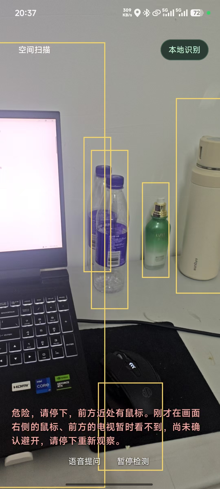
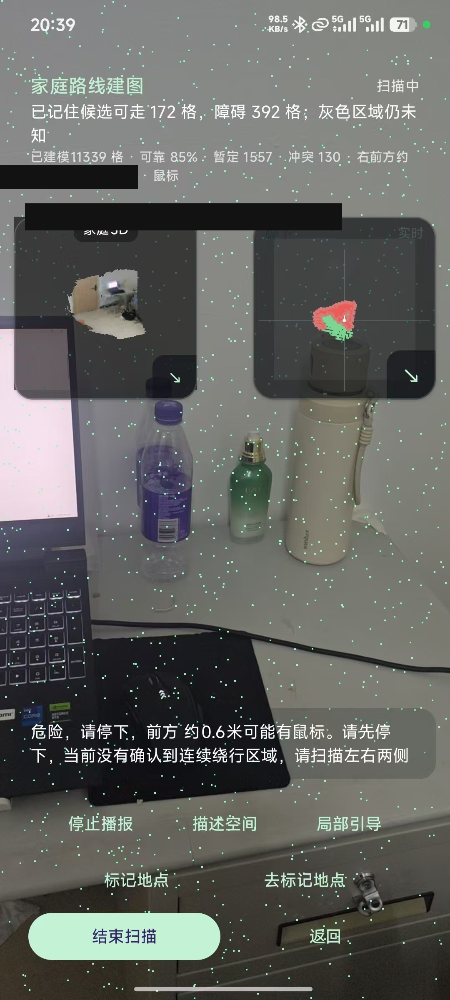
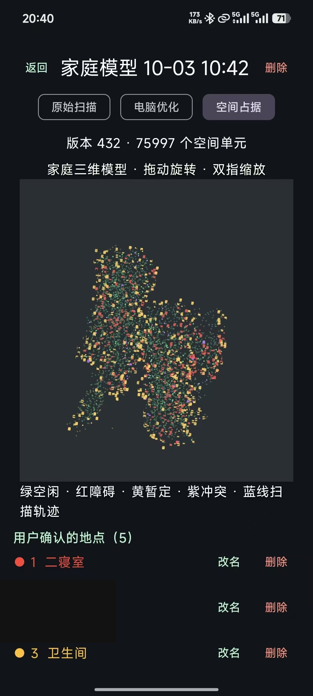
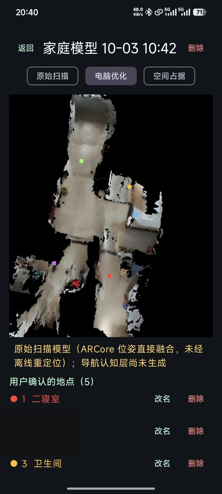
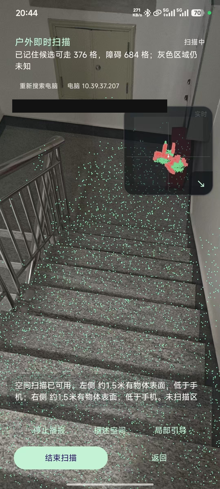

# Visual Assistant Navigation · 视障辅助空间感知与自主导航

一款面向视障用户的 Android 应用：在手机本地完成目标识别与距离感知，判断前方障碍物**是什么、在什么方向、距离多远**，并支持室内路径规划与语音播报绕行。

**全部推理在端侧完成，画面不上传，断网与飞行模式均可用。**

## 效果演示

以下均为应用真机实跑截图（已做隐私脱敏：遮挡了真实 IP 与房间名）。

<table>
<tr>
<td align="center" valign="top"><br /><b>① 实时识别 + 风险播报</b><br /><sub>检测框来自 YOLO11n，播报文案由风险引擎结合 ARCore 深度与轨迹稳定性生成</sub></td>
<td align="center" valign="top"><br /><b>② 深度融合 + 可通行栅格</b><br /><sub>绿点=已确认可走，红点=障碍及安全膨胀区；右上角为实时检测小窗</sub></td>
<td align="center" valign="top"><br /><b>③ 体素空间地图</b><br /><sub>一次扫描累积 75,997 个空间单元，每格记录可走/占据与置信度</sub></td>
</tr>
<tr>
<td align="center" valign="top"><br /><b>④ 原始扫描 vs 优化后</b><br /><sub>左=ARCore 位姿直接融合，右=经重定位优化，差异说明重定位不可省略</sub></td>
<td align="center" valign="top"><br /><b>⑤ 户外楼梯场景</b><br /><sub>可通行格统计 + 两侧表面距离播报，方案不局限于室内</sub></td>
<td align="center" valign="top"></td>
</tr>
</table>

> 更详细的设计推导见 [`docs/`](docs/README.md) —— 那里有 15 份方案对比与失败分析文档。

## 快速开始（他人 clone 后如何跑起来）

### 0. 先看这里：需要改哪些配置

本项目**默认不依赖任何后端服务器**——目标识别、深度感知、路径规划、离线语音全部在手机本地完成，clone 下来改完下面的 Key 就能直接跑。

只有两个可选功能需要外部服务：

| 配置项 | 是否必填 | 用途 | 不填的后果 |
|---|---|---|---|
| `MapSdkKey`（高德 Web 服务 Key） | 可选 | 家庭位置在位检测（判断你是否在家） | 该功能不可用，其余功能正常 |
| `ONLINE_3D_HOST`（在线 3D 后端地址） | 可选 | 把手机端的体素地图同步到 PC 端做三维重建 | 手机端本地建图不受影响，仅失去"远端渲染"能力 |

> 仓库中**不提供任何预置 APK**，原因有二：
> 1. 目标检测 + 深度融合 + 路径规划依赖 **ARCore**，只能在真机上运行，模拟器无法验证；
> 2. 各人设备与需求不同，自己构建才能保证 Key 与后端地址是自己的。
>
> 下方"完整构建步骤"会带你从零构建出一个可安装的 APK。

### 1. 环境准备

| 依赖 | 版本要求 | 说明 |
|---|---|---|
| JDK | **21**（17+ 也可） | Android Gradle Plugin 8.x 需要 JDK 17 及以上 |
| Gradle | **8.14** | **不用自己装**，仓库自带 `gradlew` 会自动下载 |
| Android SDK | compileSdk **35** / minSdk **29** | 即 Android 10 及以上；SDK 用 Android Studio 装最省事 |
| 真机 | **必须支持 ARCore** | 需装「Google Play Services for AR」 |

**先自查一下**（命令在 Android Studio 的 Terminal 里跑）：

```bash
# ① JDK 版本要 ≥ 17
java -version
# 期望看到类似：openjdk version "21.0.5"

# ② Android SDK 路径（换成你自己的）
#    Windows 通常是：C:\Users\<你的用户名>\AppData\Local\Android\Sdk
#    macOS 通常是：~/Library/Android/sdk
ls $ANDROID_HOME/platforms
# 期望能看到 android-35 这一项；没有就去 SDK Manager 里装
```

> 没装 Android Studio 也没关系 —— 只要有 JDK 21 + Android SDK 命令行工具 + `adb` 就能构建。

### 2. 克隆并配置

```bash
git clone https://github.com/NanYi-A/visual-assistant-navigation.git
cd visual-assistant-navigation
```

**2.1 创建 `local.properties`，告诉 Gradle 你的 SDK 在哪**

```bash
# Linux / macOS
echo "sdk.dir=$HOME/Android/Sdk" > local.properties

# Windows（把路径换成你自己的，注意反斜杠要写两个，或者干脆用正斜杠）
echo "sdk.dir=C:/Users/你的用户名/AppData/Local/Android/Sdk" > local.properties
```

> ⚠️ **Windows 头号坑**：`local.properties` 是 Java properties 格式，反斜杠是转义字符。
> 写成 `sdk.dir=C:\Users\you\AppData\Local\Android\sdk` 会报
> `IOException: 文件名、目录名或卷标语法不正确`（Gradle 把 `\U` 当成转义序列了）。
> **推荐直接用正斜杠** `C:/Users/you/...`，一劳永逸。
>
> 这个文件已被 `.gitignore` 忽略，每个人填自己的路径，不会互相污染。

**2.2（可选）配置高德 Key —— 想用「家庭位置在位检测」才需要**

1. 到 <https://lbs.amap.com/> 注册开发者 → 创建应用 → 添加 Key
2. **服务平台必须选「Web服务」**（选错平台会报 `INVALID_USER_KEY`）
3. 勾选「Web服务」类型时不用填域名白名单，但**建议配 IP 白名单**（填你常用出口 IP）
4. 授权 PackageName 填 `cn.visualassistant.app`

```bash
echo "MapSdkKey=你的高德Web服务Key" >> local.properties
```

> 不配也能用，只是「我现在是否在家」这个判断不可用（其余功能不受影响）。

### 3. 先跑单元测试（确认代码本身没问题）

```bash
./gradlew test
```

**预期输出**：`BUILD SUCCESSFUL`。这会跑完 **31 个测试文件**（覆盖协议栈、深度融合、风险分级、路径规划、门控与看门狗等核心逻辑）。

第一次跑会下载 Gradle 和依赖，**耐心等 3–10 分钟**是正常的。后续就快了。

### 4. 构建 APK

```bash
# 推荐：release 版（R8 混淆 + 资源压缩，体积小、跑得快）
./gradlew assembleRelease

# 或 debug 版（带调试器，方便断点调试）
./gradlew assembleDebug
```

**产物位置**（注意有 **3 个**，因为按 CPU 架构分包了）：

```
app/build/outputs/apk/release/
├── app-arm64-v8a-release.apk     ← 80MB，现代手机都用这个
├── app-armeabi-v7a-release.apk   ← 73MB，老旧 32 位手机
└── app-x86_64-release.apk        ← 82MB，模拟器用（真机装不了）
```

**该装哪个？** 看你的手机 CPU 架构：

```bash
# 连上手机后查架构
adb shell getprop ro.product.cpu.abi
# 绝大多数现代手机输出：arm64-v8a   → 装 app-arm64-v8a-release.apk
# 少数老手机输出：armeabi-v7a     → 装 app-armeabi-v7a-release.apk
```

> **为什么每个都有 80MB？** 因为内置了 YOLO11n INT8 ONNX 模型（3MB）+ Vosk 中文语音模型（42MB）+ 其他资源。`armeabi-v7a` 只是多带了一份兼容代码。
>
> **关于签名**：release 配置用的是 Android 自带的 debug keystore（`~/.android/debug.keystore`，首次构建自动生成），所以 **clone 后无需任何私钥就能构建出能直接安装的 APK**。要正式发布请自己创建 keystore，替换 `app/build.gradle.kts` 里的 `signingConfigs`。

### 5. 安装到手机

```bash
# 先连上手机（数据线 + 开发者选项里的 USB 调试）
adb devices
# 期望看到：XXXXXXXX    device

# 安装（-r = 覆盖安装，保留数据）
adb install -r app/build/outputs/apk/release/app-arm64-v8a-release.apk
```

不想用 adb 的话，把 APK 传到手机点开安装，需要在系统里允许「安装未知来源应用」。

**首次启动要授权两样：**
- 📷 **相机** —— 实时取景帧采集 + ARCore 深度感知
- 🎤 **麦克风** —— Vosk 离线语音识别

### 6.（可选）配置在线 3D 后端

**先说结论：这一步不做，App 依然完全可用。** 本地建图、路径规划、语音播报全都在手机端跑。

只有你想在电脑上看到三维重建结果、或想用重定位辅助时，才需要它。

`online3d-server/` 是一份 **Kotlin/JVM** 服务（VA3D 协议的服务端实现，含 9 个测试文件）：

```bash
# 需要 JDK 17+，在仓库根目录执行
./gradlew :online3d-server:run --args="--port 38400"
```

启动后：
- 默认监听 **38400** 端口（用 `--port` 可改）
- 体素地图写到 `online3d-server/maps/`，模型文件在 `online3d-server/models/`（都是运行时数据，不入库，首次启动自动创建）

然后在 App 的在线 3D 设置页填入**电脑的局域网 IP**（如 `192.168.1.100`）与端口 `38400`。

> 协议是自研的 VA3D 二进制格式（Magic `0x56413344` / VERSION 2 / 4 字节长度前缀 / 大端序），手机端做 revision 校验的增量同步，缺帧时请求全量快照。

### 7. 常见问题

| 现象 | 原因与解决 |
|---|---|
| 构建报 `IOException: 文件名、目录名或卷标语法不正确` | `local.properties` 里 `sdk.dir` 的反斜杠没转义。改用正斜杠：`sdk.dir=C:/Users/you/AppData/Local/Android/sdk` |
| 构建报"项目路径包含非 ASCII 字符" | Windows 下 Gradle 限制：把仓库克隆到**纯英文路径**（如 `D:\projects\visual-assistant-navigation`），或在 `gradle.properties` 加 `android.overridePathCheck=true` |
| 构建报 `Missing class com.amap.ams.gnss.GnssSoftLocator` | `proguard-rules.pro` 里已加 `-dontwarn`。若仍报错，确认你用的是仓库内的规则文件（别自己另建一个） |
| `./gradlew` 报 `JAVA_HOME is not set` | 装 JDK 21 并设环境变量：`export JAVA_HOME=/path/to/jdk-21`（Windows 在系统环境变量里加 `JAVA_HOME`） |
| `./gradlew` 卡在下载依赖 / 一直转圈 | 首次构建要下 Gradle 8.14 + 全部依赖，国内网络建议配 Gradle 镜像（`~/.gradle/init.gradle`） |
| 装 APK 提示「应用未安装」 | 装错架构了。x86_64 是模拟器专用的，真机必须用 `arm64-v8a` |
| 启动后相机画面黑屏 | 设备不支持 ARCore，或没装「Google Play Services for AR」；也可能是没给相机权限 |
| 提示"暂无可靠深度" | ARCore 深度需要室内有充足纹理（白墙、空旷地面效果最好）；项目已用 `DepthStreamGate` 处理时间戳不同步的情况 |
| 一直提示"位置未知" | 没配 `MapSdkKey`，或室内无 GPS 环境（正常现象，不影响其他功能） |
| 语音指令无响应 | 没给麦克风权限；飞行模式下也能用（Vosk 模型已内置，不依赖网络） |

## 功能一览

### 感知层：把"看见"变成"知道在哪"

| 功能 | 实现 | 有什么用 |
|---|---|---|
| **物体识别** | YOLO11n INT8 ONNX（3.0MB） | 回答"前方是什么"。模型刻意压到 3MB 量级，才能随 APK 离线分发而不是依赖服务器推理 |
| **距离感知** | ARCore Raw Depth + 深度融合 | 回答"它离我多远"。单靠检测框只知道有什么、不知道多远；把检测框与深度流做几何关联后，才得到"什么物体 / 什么方向 / 多远"这组完整信息 |
| **旋转补偿** | 按 0°/90°/180°/270° 分别变换坐标 | 摄像头预览与深度图存在旋转差，不补偿就会框错位置 |
| **可信度判据** | 深度点分位距（3/4 位 − 1/4 位） | 深度散乱说明这次定位不可信，直接丢弃该结果而不是给用户一个错的距离 |
| **时间戳门控** | `DepthStreamGate` | 只接受时间戳严格递增的深度流，避免过期数据被当成新证据写入地图 |
| **障碍物记忆** | `ObstacleMemory`（有界视觉历史） | 记住"刚才那个障碍还在" —— 但只做局部暂定关联，绝不当作世界坐标 |

### 决策层：决定"要不要提醒、提醒什么"

| 功能 | 实现 | 有什么用 |
|---|---|---|
| **风险分级** | `RiskEngine`（纯 Kotlin 策略） | 输出 SAFE / NOTICE / WARNING / DANGER 四级。纯策略实现意味着不依赖相机与 UI，可独立测试 |
| **稳定帧确认** | 同轨迹连续 2 帧才升级告警 | 过滤单帧噪声——否则一次误检就会让用户误以为危险 |
| **告警冷却与升级** | 升级立即触发、常规 4s 冷却 | 同一危险反复播报会让人烦躁甚至直接关掉 App |
| **方向与远近判定** | 归一化坐标分档（<0.36 左 / >0.64 右） | 把检测框转成"左前方近处有…"这样的可执行提示 |
| **绕行建议** | `AvoidanceGuide` | 依据画面占用情况给出"往哪看、往哪走"的建议 —— 但明确只说"该往哪看"，不谎称是已验证的可通行路线 |
| **场景描述** | `SceneDescriber` | 只依据最近的检测结果描述场景；**没有检测到 ≠ 前面安全**，绝不这样解读 |
| **变化播报** | `RecoveryTracker` | 持续检测结果发生变化时播报（比如"障碍移开了"），但不声称"这条路能走" |

### 地图与导航层：记住家在哪，并带路过去

| 功能 | 实现 | 有什么用 |
|---|---|---|
| **体素空间地图** | `SpatialMap` | 把多次观测累积成 3D 栅格，每格记录可走/占据与置信度，跨会话持久化 |
| **家庭地图** | `HomeMap` | 一个家的已确认世界格子，独立于某次扫描会话长期保留 |
| **路径规划** | `HomeRoutePlanner`（A\*） | 在已知地图上算出到"厨房""门口"这类语义目的地的路径 |
| **失败原因分类** | 5 类枚举：无起点 / 目标未观测 / 被阻断 / 过窄 / 不连通 | 不同原因需要用户做不同动作，说清楚"为什么走不过去"比只说"失败"有用得多 |
| **通行宽度校验** | 按走廊实际宽度计算，仅豁免首尾 30cm | 保留门洞处的真实狭窄判定，不会因为"只走了 10 厘米"就判定可过 |
| **路径平滑** | 拉直 + 转角，且只保留处处已确认可通的版本 | 网格锯齿路径若直接播报"左转 90 度"，会把人送进墙里 |
| **导航就绪度** | `HomeNavigationReadiness` | 有扫描记录 ≠ 有可用导航地图；必须通过人体通行宽度检查才算就绪 |
| **导航会话** | `HomeNavigationSession` | 掌管"带我去卫生间"这类请求的完整生命周期：目标 → 路径 → 逐段指令 → 到位确认 |
| **转向重试策略** | 失败几次后放弃并说明原因 | 一直重复同一条无效指令会让用户彻底失去信任 |
| **家庭在位检测** | `HomeGeoPresence` + 高德定位 | 判断人是否在家，是自动发起导航还是需要先回家的前置判断 |
| **在位安全闸** | `HomeNavigationCore` | 视觉匹配结果与每条路线指令之间的安全闸 —— 匹配不可靠就不给指令 |
| **后端自动发现** | `BackendDiscovery` | 电脑 IP 变化（手机开热点重新分配）后自动找到新地址，不用手动改配置 |

### 输出与交互层：怎么把信息告诉用户

| 功能 | 实现 | 有什么用 |
|---|---|---|
| **离线语音识别** | Vosk 中文小模型（42MB） | "帮我去厨房""停一下"这类指令在飞行模式下照样可用，不依赖系统服务与第三方 API |
| **播报优先级仲裁** | `SpeechArbiter`（纯队列策略） | 危险告警可以抢占正在播报的内容；等待类状态每 15 秒提醒一次；问答过程中只震动不发声 |
| **播报状态唯一来源** | `FeedbackController` | "助手正在说话/正要说话"只有一个真相来源，UI 与看门狗都读它 |
| **只播最新状态** | `SpatialVoicePrompts` | 不排队播报过期指令，也绝不在每一渲染帧都说话 |
| **采集看门狗** | `FrameWatchdog`（2.5s 警告 / 5s 终止） | 跑在 UI tick 上，不依赖 TTS 就绪 —— 否则静音或慢 TTS 会把采集看门狗一并废掉 |
| **摄像头帧快照** | `YuvFrame` | ARCore CPU 图像的廉价快照，避免在 GL 线程上做整帧拷贝 |

### 在线三维层：把重活交给电脑

| 功能 | 实现 | 有什么用 |
|---|---|---|
| **VA3D 协议** | 自研二进制协议（Magic `0x56413344` / VERSION 2 / 4 字节长度前缀 / 大端序） | 手机与远端三维服务之间的实时几何同步，带版本号便于演进 |
| **最新帧优先发送** | `Online3dClient` | 采集永远不会被慢速网络阻塞 —— 网络差就丢帧，不能拖住感知 |
| **远端体素地图** | `RemoteVoxelMap` + revision 校验 | 手机端显示缓存做增量同步（Applied / WrongSession / SnapshotRequired / Stale 四态），缺帧时要求快照而非猜测几何 |
| **彩色模型显示** | `Color3dClient` / `Color3dProtocol` | 独立的 RGB-D 显示通道，失败也不影响导航主链路 |
| **真实深度缓冲渲染** | `ColoredMeshSurface`（GLSurfaceView） | Compose Canvas 无法正确光栅化相交的三维网格，必须用真正的深度缓冲渲染器 |
| **远程网格质量报告** | `RemoteMapQuality` | 保守地报告已观测格子，绝不把未知区域说成"已扫描" |

## 核心能力

| 能力 | 技术实现 | 解决的问题 |
|---|---|---|
| 物体识别 | YOLO11n 导出 INT8 ONNX（3.0MB） | 回答"前方是什么"；模型压到 3MB 量级才能随 APK 离线分发 |
| 距离感知 | ARCore Raw Depth | 回答"它离我多远"；单靠检测框只知道有什么、不知道多远 |
| 空间融合 | 检测框与深度流几何关联 | 二者互补，才得到"什么物体 / 什么方向 / 多远"这组完整信息 |
| 地图构建 | 体素地图（VoxelMap） | 把多次观测累积成可持久化的家庭/办公室平面图 |
| 路径规划 | A\* + 路径平滑 | 在已知地图上算出到目标（厨房、门口）的可行路径并给出转向与距离指令 |
| 离线语音 | Vosk 中文小模型（42MB） | 语音指令在飞行模式下照样可用，不依赖系统服务与第三方 API |
| 远端同步 | 自研 VA3D TCP 协议 | 手机端与远端三维服务实时同步几何数据，手机不必独自承担整屋三维重建 |

## 架构

```
Camera (ARCore)
    │
    ├─► YOLO11n INT8 ONNX ──► 检测框 (类别 / 置信度 / bbox)
    │                              │
    └─► Raw Depth ────────────► 深度点云 ──┴─► SemanticDepthFusion
                                             │  旋转补偿 → 框内取交集 → 中位数定位
                                             │  → 分位距作离散度 → 不可信则丢弃
                                             ▼
                                  SpatialMap（体素地图）+ HomeRoutePlanner（A*）
                                             │
                                             ▼
                              RiskEngine（纯策略）+ SpeechArbiter（播报仲裁）
                                             ▼
                                        Vosk ASR / 语音播报
```

## 工程设计要点

- **策略层与设备层解耦**：`RiskEngine` 是纯 Kotlin 实现，不依赖相机与 UI，可独立测试；告警要求同一轨迹连续 2 帧稳定才升级，常规告警 4s 冷却。
- **失败原因可枚举**：路径规划失败显式分类为 `NO_START` / `GOAL_UNKNOWN` / `BLOCKED` / `TOO_NARROW` / `DISCONNECTED`，每种对应不同的用户处置建议，而不是一句"走不过去"。
- **宁缺毋滥**：深度证据需同时满足置信度 ≥180/255、深度 0.25–6m、同一 20cm 区域两个不同视角测量一致，才认为是真实表面。
- **拒绝虚假指引**：手机朝天/朝地导致朝向投影失真时**直接不播报转向**；平滑后的路径若穿过未观测区域则标记 `crossesUnknown`，不假装安全。
- **两级看门狗**：`FrameWatchdog`（2.5s 警告 / 5s 终止采集）跑在 UI tick 上，不依赖 TTS 就绪状态，避免静音或慢 TTS 把采集看门狗一并废掉。
- **协议版本化**：VA3D 协议带 Magic（`0x56413344`）、VERSION、消息类型与 4 字节长度前缀；远端体素地图做 revision 校验的增量同步（`Applied` / `WrongSession` / `SnapshotRequired` / `Stale` 四态），缺帧时要求快照而非猜测几何。

## 目录结构

```
app/src/main/java/cn/visualassistant/app/
├── core/         基础数据模型（Detection / RiskAssessment / RiskLevel）
├── camera/       相机帧采集
├── inference/    YOLO 推理与 letterbox 预处理
├── spatial/      空间地图、深度融合、路径规划、门控与看门狗
├── online3d/     VA3D 协议栈与远端体素地图同步
├── feedback/     播报仲裁与反馈控制
├── risk/         风险评估策略与避障建议
└── home/         家庭在位检测与高德定位

online3d-server/  VA3D 协议的 Kotlin/JVM 服务端实现（含 9 个测试文件，可选部署）
tools/            Python 侧的协议、导航与 3D 工具脚本（含单元测试）
docs/             15 份设计文档与方案对比（docs/README.md 有索引）
docs/images/      5 张真机运行截图（已脱敏）
```

## 单元测试

策略层与协议层实现了 **32 个 JVM 单元测试文件**（`app/src/test/`），覆盖：

- **协议栈**：`Online3dProtocolTest` / `RemoteVoxelMapTest` / `RemoteMapProtocolTest` / `RemoteMapQualityTest` / `RemoteMeshProtocolTest` / `Color3dProtocolTest` / `HomeControlProtocolTest`
- **空间与感知**：`SemanticDepthFusionTest`（深度融合与离散度判据）/ `DepthStreamGateTest`（时间戳门控）/ `SpatialMapTest` / `TraversabilityGridTest` / `HomeMapTest` / `LetterboxTest`
- **决策与播报**：`RiskEngineTest`（告警升级与冷却）/ `AvoidanceGuideTest` / `SpeechArbiterTest`（播报抢占）/ `FrameWatchdogTest`（两级看门狗）/ `RecoveryTrackerTest`
- **导航与在位**：`LocalNavigatorTest` / `HomeNavigationCoreTest` / `HomeNavigationReadinessTest` / `HomePresenceEvidenceTest` / `HomeGeoPresenceTest` / `BackendDiscoveryTest`
- **语音与描述**：`ObstacleMemoryTest` / `SceneDescriberTest` / `SpatialVoicePromptsTest` / `PlaceNameTest` / `ScanModeTest`

```bash
./gradlew test
```

## 权限说明

| 权限 | 用途 |
|---|---|
| `CAMERA` | 实时帧采集与 ARCore 深度感知 |
| `RECORD_AUDIO` | Vosk 离线语音识别 |

应用不申请网络权限用于数据上传，所有推理与识别均在设备本地完成。

## 致谢

- [Ultralytics YOLO](https://github.com/ultralytics/ultralytics) — YOLO11n 检测模型
- [Vosk](https://github.com/alphacep/vosk-api) — 离线中文语音识别
- [ARCore](https://developers.google.com/ar) — 房间级深度感知

## 许可证

MIT License
